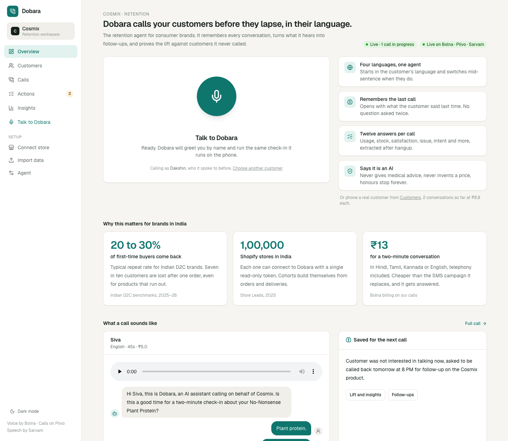
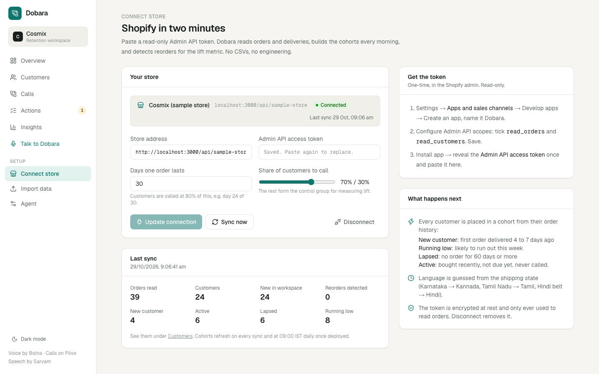
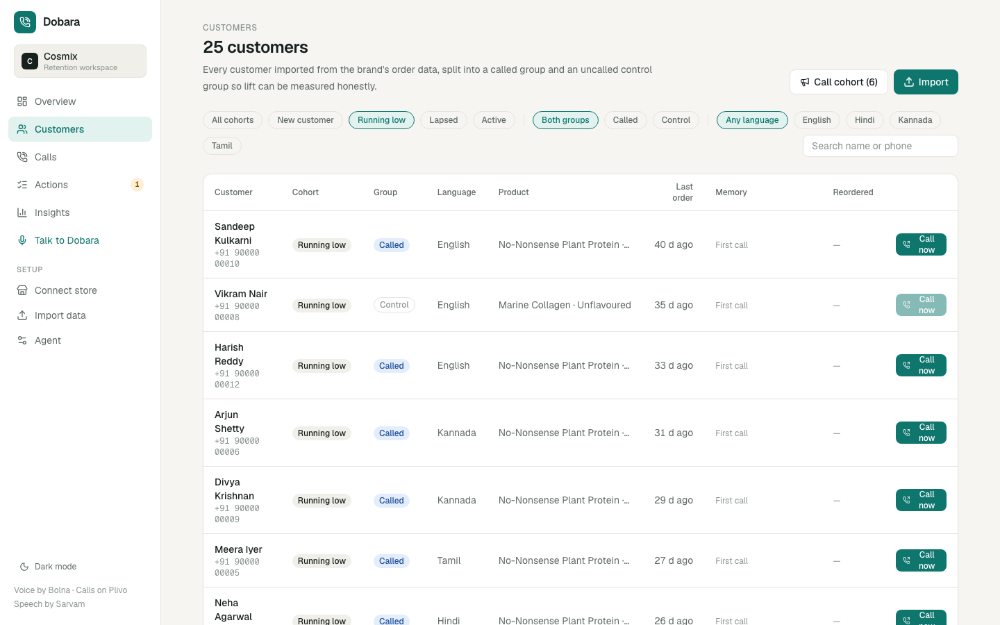
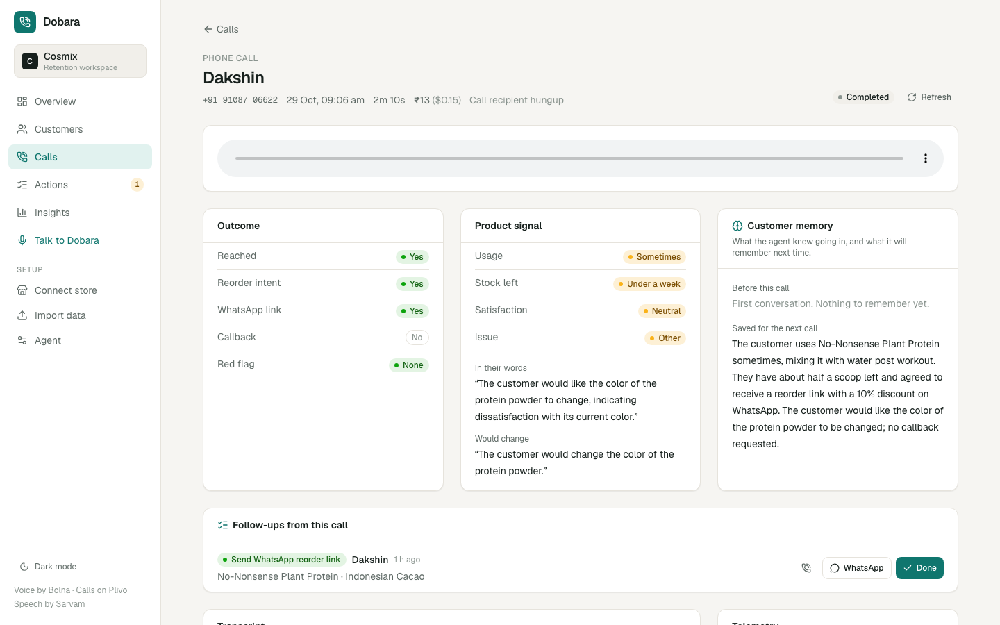
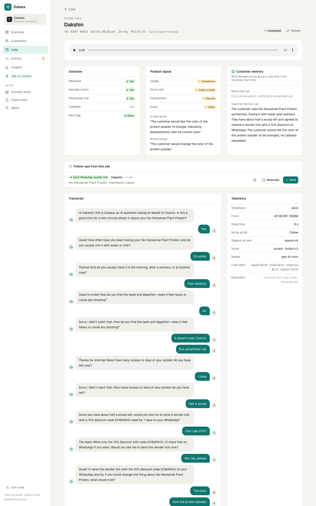
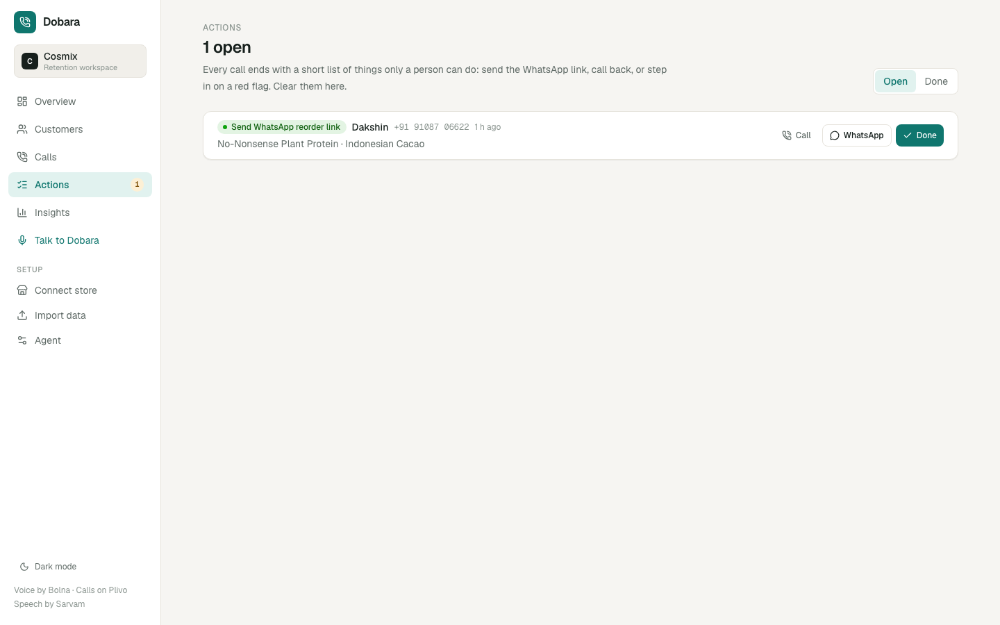
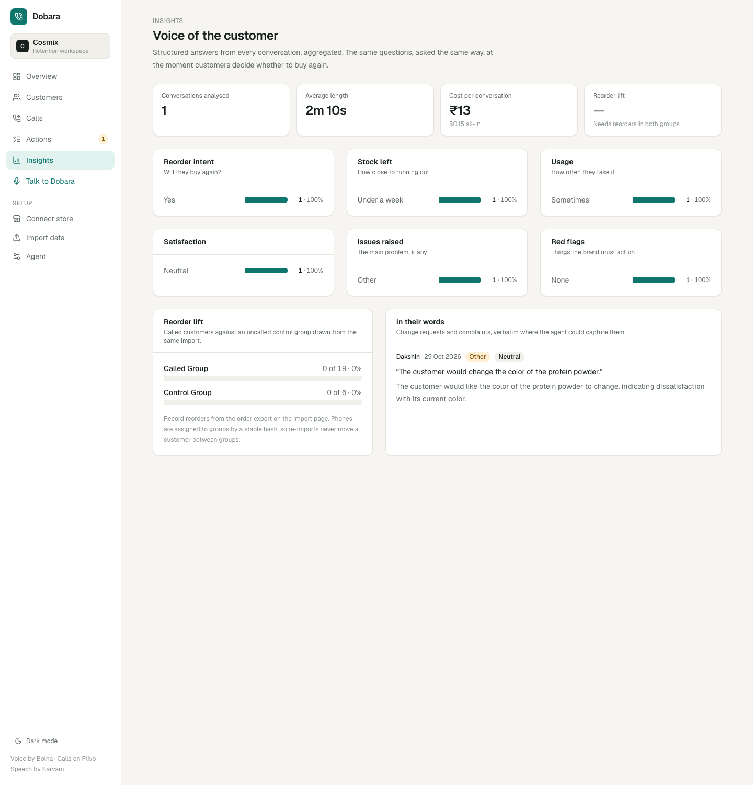
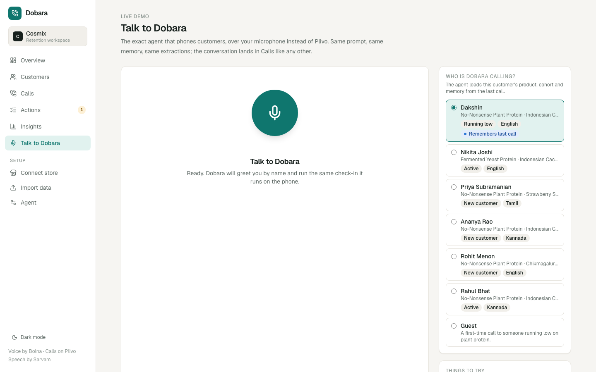
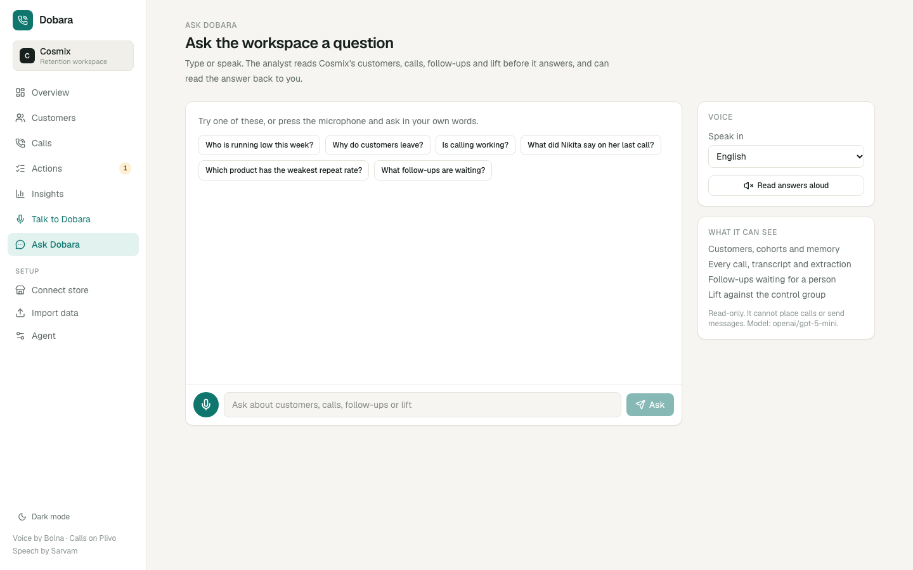
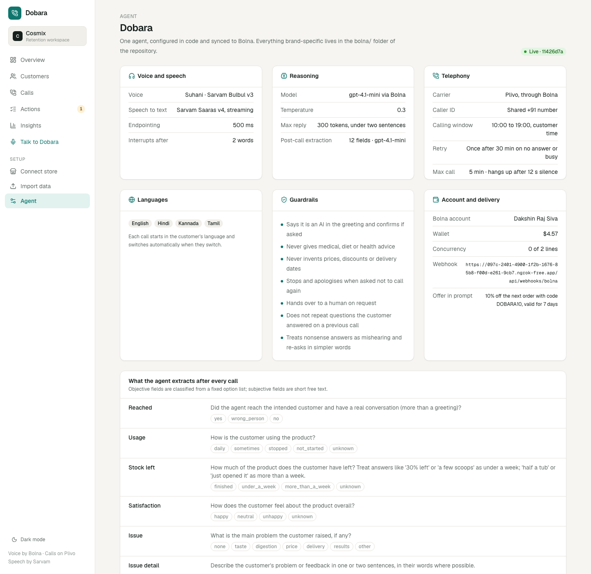

# Dobara demo: screen by screen

Six minutes live, or the backbone of the two-and-a-half-minute video. Each step: the screen, what to click, what to say. Screenshots are in `docs/demo/` (light mode, 1440×900, taken from the running app on 29 October with the sample store connected).

Before you start: Bolna wallet topped up, `pnpm agent:sync` run against the current webhook URL, your phone on the table with the ringer on, microphone allowed in the browser. If the phone path fails, step 5 happens on the Talk to Dobara page instead; it is the same agent.

---

## 1. Overview (30 seconds)

**On screen:** the retention health of the customer base. Six numbers across the top, the lifecycle split, why customers leave, called versus control, the funnel, and a per-product table.

**Say:** "This is what a retention lead at Cosmix opens in the morning. Repeat rate, days between orders, how many customers run out this week and what that is worth, how many have lapsed. The bar is the whole base by stage. Below it, why customers leave, in their own words from the calls, and whether calling them changes anything, measured against a control group we never call. Every number on this page comes from the store's orders and from Dobara's conversations."

**Click:** Connect store in the sidebar.

## 2. Connect store (40 seconds)

**On screen:** the connected sample store, the token field, days one order lasts, the called-versus-control slider, the last sync summary.

**Say:** "Onboarding is one token. The brand creates a read-only app in Shopify admin, copies the key, pastes it here. That is the whole integration."

**Click:** Sync now. Wait two seconds, then read the result line aloud.

**Say:** "Thirty-nine orders, twenty-four customers. Four just had their first delivery, eight are about to run out, six have lapsed, six are not due yet. Language is guessed from the shipping state, so a customer in Chennai gets the call in Tamil. And every customer is assigned to the called group or the control group by a stable hash, so we can measure lift honestly."

**Click:** Customers in the sidebar, then the Running low filter.

---

## 3. Customers, running low (30 seconds)

**On screen:** the running-low cohort, called and control badges, language, product, days since last order, the memory column.

**Say:** "These are the people about to run out this week. Dobara calls them at eighty percent of the days a tub lasts. The ones marked control are never called; they are how we prove the lift."

Point at your own row.

**Say:** "This one is me. I spoke to Dobara two days ago, and it remembers: how I take it, what I had left, that it promised me a link. The next call opens with that."

**Click:** Call now on your row.

---

## 4. The call (two minutes)

**On screen:** the status badge on your row flips to Dialling. Your phone rings from a +91 80357 number. Put it on speaker.

**Say, before answering:** "It is calling me on Plivo through Bolna. Same agent that calls customers."

**Say to the agent, roughly in this order:**

- "Yes, it's a good time." (greeting handled)
- "Most mornings, with water." (usage)
- "It feels a little heavy sometimes." (digestion; the agent will not give medical advice)
- "About three scoops left." (stock: under a week, which triggers the offer)
- "Haan, WhatsApp pe bhej do." (language switch, consent for the link)
- "Are you a bot?" (it says yes)
- "I'd make the mocha less sweet." (change request)

Let it close the call itself. Hang up.

**Say to the room:** "Two minutes. It handled an interruption, a language switch, a health comment and a product opinion, and it never quoted a price it was not given."

**Click:** Calls in the sidebar; the new row flips to Completed within thirty seconds. Open it.

---

## 5. Call detail (45 seconds)

**On screen:** the recording, three cards: Outcome, Product signal, Customer memory.

**Say:** "Every call ends with twelve structured answers. Outcome: reached, will reorder, wants the WhatsApp link. Product signal: usage, stock, satisfaction, the issue, and the customer's own words. And memory: what the agent knew going in, and what it saved for next time."

Scroll down.

**Say:** "The promise it made became a task for the team, and here is the transcript. The same questions, asked the same way, to every customer, in their language."

**Click:** Actions in the sidebar.

---

## 6. Actions (30 seconds)

**On screen:** the open queue: Send WhatsApp reorder link, customer name, product.

**Say:** "The agent does not send marketing by itself. A person presses send."

**Click:** WhatsApp. WhatsApp opens with the message written: the product, the reorder link, the offer code.

**Say:** "Callbacks, complaints and anyone who says stop calling land here too. Red flags are routed, not buried in a transcript."

**Click:** Done, then Insights in the sidebar.

---

## 7. Insights (40 seconds)

**On screen:** distributions for reorder intent, stock, usage, satisfaction, issues and red flags; the lift card; quotes.

**Say:** "Across every conversation: who intends to reorder, how close they are to running out, what they would change. This is voice-of-customer data the brand has never had, by flavour, every day."

Point at the lift card.

**Say:** "And this is the number the brand pays for. Called group against control group, by reorder rate. When Cosmix's reorders flow in from Shopify, this fills in by itself. One saved reorder pays for fifty to eighty conversations, so the brand is ahead at a one-point lift."

---

## 8. Talk to Dobara (backup, or for a judge to try)

**On screen:** the microphone button, the persona picker (a real customer with memory, or a guest), things to try.

**Say:** "Same agent over the browser microphone. Pick a customer and it loads their product and memory. Judges can try it on the live link."

**Click:** the microphone. Speak. End the call; the transcript and extractions appear within thirty seconds.

---

## 8b. Ask Dobara (30 seconds)

**On screen:** a chat over the workspace with a microphone. Suggested questions, a language picker for speech, a "read answers aloud" toggle.

**Say:** "The same data, by voice. Ask it who is running low, why customers leave, what Nikita said on her last call. It reads the customers, the calls and the lift before it answers, and it answers in Hindi, Tamil or Kannada if you ask in them."

**Click:** the microphone, ask "who is running low this week?", let it answer, then switch on read-aloud and ask "is calling working?".

## 9. Agent (interview only, 20 seconds)

**On screen:** voice, model, telephony, languages, guardrails, account, the twelve extraction fields, the greeting, the prompt.

**Say:** "Everything brand-specific is a few files in the repo. Sarvam for speech, a small GPT model, Plivo for the call, and these guardrails: it says it is an AI, never gives medical advice, never invents a price, and honours stop forever."

---

## Close

**Say:** "Every brand on Shopify can do this with one token. Cosmix is first; the Marico portfolio is next. We charge thirty rupees per reached conversation, and the control group tells the brand exactly what it got for it."

Then stop talking.

---

## For the video

Record at 1440×900 in light mode with the sidebar visible. Use the screens in the order above, cut the call to its best sixty seconds with subtitles, and end on the lift card. Skip the Agent page.
